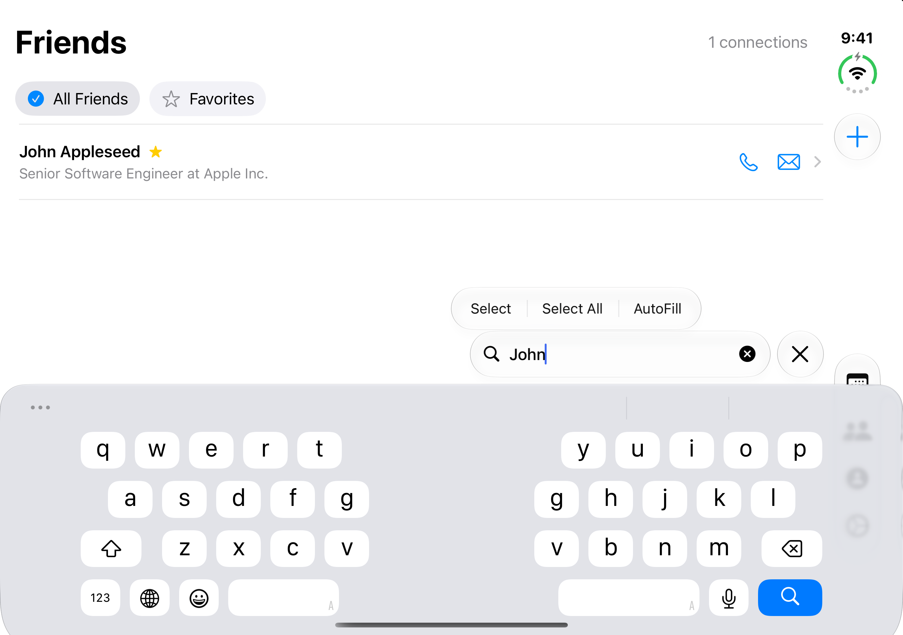
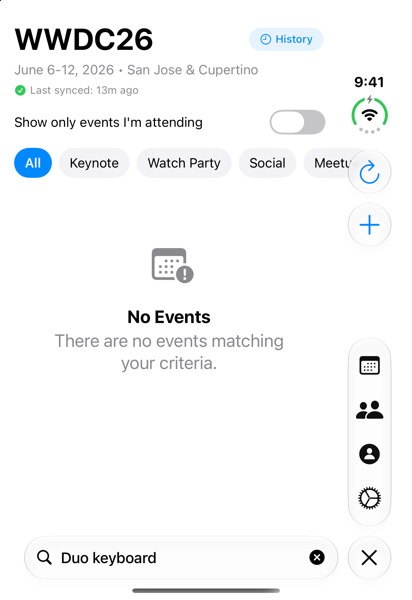
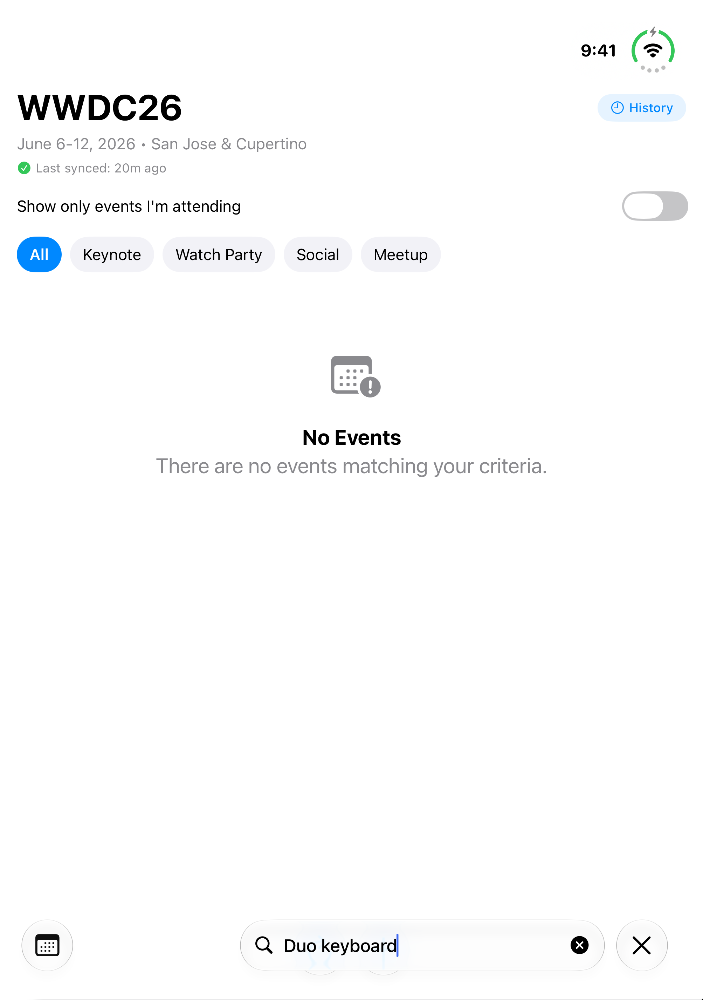
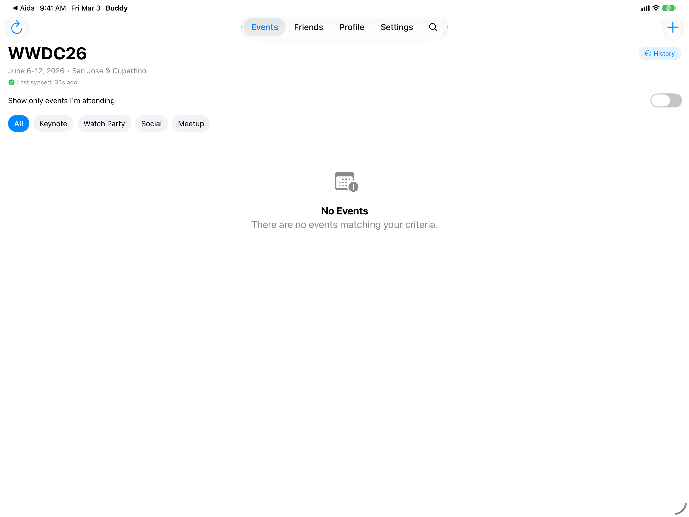

# iPhone Duo verification — October 17, 2026

## Scope and change

`ContentView` now keeps the contextual Search tab at all iOS widths. Previously,
regular width removed it and switched the main lists to toolbar search. Folding
or unfolding during search could change the selected tab and discard the active
search flow. Keeping the tab and search presentation stable preserves the owners
of query, filter, navigation, and sheet state.

Regular-width iPad search consequently uses the Search tab too. macOS and
visionOS conditional branches, branding, bundle ID, and compatibility identifiers
were not changed. Existing project, package-resolution, and Xcode Cloud work was
preserved. No App Store Connect operation was performed.

## Environment and build

- Xcode: `/Applications/Xcode-27.1.0-Release.Candidate.app`.
- Simulator: iPhone Duo, iOS 27.1, `A3146FF4-B98B-4D20-9364-22CE16615119`.
- Project/scheme: `EventBuddy.xcodeproj` / `EventBuddy`.
- `xcode-cli` skill/executable unavailable; used the authorized raw `xcodebuild`
  fallback. No XcodeBuildMCP build/test/clean command was used.
- Native default DerivedData:
  `~/Library/Developer/Xcode/DerivedData/EventBuddy-bzvqoyidobtcdrfbanyvvpfaayzu`.
- Final build: `BUILD SUCCEEDED` (96.900 sec), then installed and launched.
- Full build log: `/tmp/eventbuddy-duo-build-final.log`.
- `git diff --check` passed.

Build command:

```sh
xcodebuild -project EventBuddy.xcodeproj -scheme EventBuddy \
  -destination 'platform=iOS Simulator,id=A3146FF4-B98B-4D20-9364-22CE16615119' \
  -disableAutomaticPackageResolution build
```

## Observed runtime checks

Device Hub's Closed, Open, and Partially Open controls performed actual pose
transitions. The app used the outer portrait and inner landscape/portrait displays.

| Check | Observation |
| --- | --- |
| Baseline outer search → open | `Duo continuity` disappeared; Events became selected and its toolbar search was empty. |
| Corrected closed → open → partial → closed | `Duo continuity` remained in the active Events search field. |
| Add Event outer → open | Unsaved `Duo unsaved draft` title remained; inner sheet showed Cancel and Save. Draft was cancelled. |
| Friends contextual search → closed | `John` query and matching sample friend remained. |
| Friend detail → partial → back | John Appleseed detail remained; back returned to results with `John` retained. |
| Partial inner display with software keyboard | Split keyboard and `John` search field were visible; search stayed above the keyboard. |
| Keyboard search without edit menu, partial → closed | `Duo keyboard` query survived; app process 91552 remained running. The system dismissed the software keyboard on the outer display. |
| Open landscape → open portrait | `Duo keyboard` remained, with native bars moving to horizontal layout; captured inner display was 2007 × 2853 pixels. |
| iPad regular-width launch | Same built app installed/launched on AidaPromo-iPadPro13 (iOS 27.0, `E6630245-CED5-4BF5-8DB2-F0168D040074`); Search tab visible in top bar. Automated tap did not visibly activate search, so interaction remains unverified. |

Hardware-keyboard simulation was restored after software-keyboard verification.









## Remaining crash and verification limits

One partial → closed transition with software keyboard **and the text-edit menu
(Select / Select All / AutoFill) open** terminated process 84894:

```text
CALayerInvalidGeometry: CALayer position contains NaN: [nan inf]
delegate = <_UIEditMenuListView ... bounds = CGRect (0 0; 0 44) ...>
_UIEditMenuContentPresentation _reloadMenuLayoutWithSourceRect:animated:
_UIEditMenuContentPresentation _updateMenuPositionAnimated:reuseTargetRect:forced:
UITrackingElementWindowController willRotateToInterfaceOrientation:duration:
```

The captured throw stack contains UIKit/QuartzCore frames, not an EventBuddy
frame. This suggests framework menu positioning, but does not prove an OS bug.
Settings survived a comparable menu-open fold. A small native SwiftUI Search-tab
probe built successfully; its runtime comparison was inconclusive because other
active work repeatedly changed the shared Device Hub window. The disposable
probe app was removed and EventBuddy restored. No speculative private API,
menu suppression, or resize-triggered keyboard dismissal was added.

Full crash output:
`/tmp/eventbuddy-duo-evidence/eventbuddy-crash-runtime.log`.
Probe source/build/runtime evidence: `/tmp/EventBuddyDuoSearchProbe` and
`/tmp/eventbuddy-duo-evidence/probe-{build,runtime}.log`.

This is **not a full Duo release-readiness sign-off**. All
rotations, physical Duo, iPad search interaction, macOS/visionOS builds and runtime, event
detail navigation, saved draft persistence, and the edit-menu crash resolution
remain unverified. The current-date Events list was empty; Friend detail was
exercised using the existing sample friend. No automated UI suite was added.

## References checked

- Apple's installed App Resizability skill, exported with `xcrun agent skills export`.
- [Prepare for iPhone Duo](https://developer.apple.com/iphone-duo/prepare/).
- [Adaptive layouts](https://developer.apple.com/videos/play/tech-talks/111463/).
- [Vertical system bars](https://developer.apple.com/videos/play/tech-talks/111462/?time=189).
- Installed SwiftUI 27.1 interfaces and simulator command help.

Source audit found no iOS/shared screen-size, orientation, idiom, or manual
safe-area/keyboard calculations requiring replacement. Generated launch screen,
scene manifest, and all four iPad orientations were already configured; no
full-screen opt-out was found. Existing system Forms provide keyboard avoidance.
